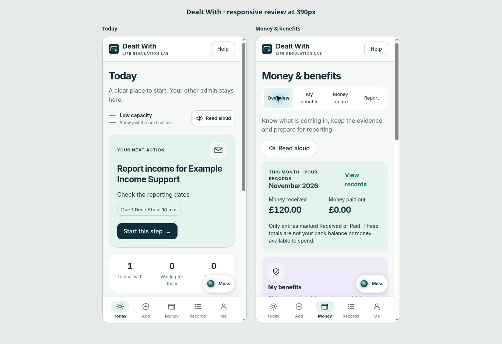

# Dealt With: appearance, executive function and money records

6 November 2026. Implementation branch: `codex/dealt-with-clarity-money`.

## Outcome

The starting app presented similar-looking lists and had no dedicated benefits or money tracker in the inspected main branch. This update gives Today one primary action, distinct pastel sections, persistent navigation, shorter settings and a clearly labelled Moss button. Existing letters, task steps, pause/resume, proof, renewals, supporter handoff and accessibility controls remain available.

## Public comparisons

These observations come from public pages and demonstrations, not private apps or decompiled code. ClariDoc's public demo and Tiimo's visual-planning page were inspected visually. Other comparisons use their published product descriptions and screen material.

| Source | Useful pattern | Applied here |
| --- | --- | --- |
| [Tiimo visual planning](https://www.tiimoapp.com/product/visual-planning) | Distinct coloured activities and visible organisation | Soft mint, lilac, peach and blue sections; one clear next action |
| [ClariDoc demo](https://claridoc.app/demo) | Source material, summary, amounts, dates and action checklist | Keep benefit letters linked to dates and payments; open the existing letter helper from the claim |
| [Goblin Tools](https://goblin.tools/) | Small tools for specific difficulties, including breaking down tasks | Keep the existing Stuck flow prominent; open benefit reporting as four saved steps |
| [Snoop](https://snoop.app/how-it-works/) | Separate money overview and bill/transaction functions | Overview, My benefits, Money record and Report each have an explicit purpose |
| [PaperFix](https://paperfix.app/) | Explain photographed correspondence and help with replies | Reuse the existing consented letter helper; no extra AI provider or new data-sharing route |

These are design inputs, not a claim of measured usability superiority. Testing with people who have executive dysfunction remains necessary.

## New functions and boundaries

1. **Today:** one prominent next action, deadline, estimated step time, low-capacity mode, readable counts, resume route and shortcuts. Urgent dates remain available. The five-item bottom bar stays visible on long pages.
2. **My benefits:** name, jurisdiction and claim stage first; optional sections hold reporting dates, review dates, payment schedules, references, notes and a linked letter. Archive and restore are available.
3. **Expected payments:** weekly, fortnightly, four-weekly, monthly or one-off schedules. Dates are derived from the original anchor, including month-end dates. Nothing is automatically marked received. A delayed receipt retains its scheduled occurrence, so the same payment is not prompted again.
4. **Money record:** exact integer-pence amounts, actual transaction dates, separate expected/received/paid states and six categories. Evidence can be a reference, note or linked letter/task. Existing local-only photo storage continues to apply.
5. **Prepare a report:** inclusive custom reporting dates, separate category totals, individual entries and missing-evidence prompts. Expected and archived entries do not count as received/paid. The user checks the records before saving CSV. Changes to dates or entries invalidate that check. A known cloud sync error blocks export.
6. **Deadline tasks:** reporting and review dates can become ordinary saved tasks with a stable identifier, notification integration, a proof step and direct links back to the benefit and report. A generated task suppresses a duplicate automatic reminder for that date.
7. **Persistence:** benefits and money collections participate in local storage, account transfer, account deletion and JSON backup/import. Import validates the new record types. Cloud read/write failures now produce a visible warning.

Totals describe recorded transactions. They are not a bank balance, money available to spend, assessed benefit income or an entitlement calculation. The app does not connect to a bank, decide eligibility or submit a report.

The report includes all recorded income/expenses in the chosen dates, across benefits; it is not silently filtered to the named claim. Wages are labelled take-home pay; business income and expenses are separate. An expense entry does not establish that it is allowable for a particular benefit.

## Jurisdiction and AI

Guernsey, Jersey and the UK nations are distinct choices. UK Universal Credit rules are not applied to Channel Islands records. The app points users to the relevant official service/advice source and asks them to copy dates and required figures from their own letter or account.

- [UK guidance on reporting self-employed earnings](https://www.gov.uk/government/publications/universal-credit-for-the-self-employed/how-to-report-your-earnings-from-self-employment): reporting periods and actual business receipts/expenses need to be distinguished from general household money.
- [Turn2us calculator coverage](https://www.turn2us.org.uk/get-support/information-about-benefits/who-can-use-the-turn2us-benefits-calculator): the calculator does not cover the Channel Islands.
- [Citizens Advice Guernsey](https://citizensadvice.org.gg/) and [UK benefits](https://www.gov.uk/browse/benefits) are linked for jurisdiction-appropriate help.

AI remains useful for explaining a linked letter, drafting replies, call preparation and breaking down steps. Existing Plus/consent controls remain. Financial totals, payment scheduling and reporting dates use deterministic code. This update does not ask an AI model to calculate entitlement or determine reportable income.

## Verification

`npm run check`: TypeScript, ESLint, production build and **130 tests across 21 files** pass, including **29 money tests**. `git diff --check` passes.

The money tests cover malformed amounts/imports, penny precision, inclusive and non-calendar date ranges, month ends, leap years, actual 28-day payments, expected/received separation, delayed receipts, duplicate suppression, archive exclusion, CSV formula escaping, stable task identifiers, reminder deduplication and local persistence/account-transfer collection coverage.

Browser checks used fictional records in the development preview: create a Guernsey benefit, save its reporting period, record a delayed £120 payment, reload and recover the records, verify the next expected date, prepare/download a checked report, create its reporting task and use low-capacity mode. Today, Money and Report were visually checked at a 390px frame width, with no horizontal overflow on the report. A development hot-reload context error cleared on full reload; it was not reproduced in the completed loaded preview.

## Release state and remaining checks

This is a prepared source update. It has not been deployed to Firebase or distributed as a new iOS build. The Firebase publishing connection is not available in this session. The existing live website was older than the inspected main branch, so a deployment would also include pre-existing main-branch changes.

Before production release, verify authenticated Firestore save/reload across devices, account transfer/deletion, denied-write behaviour, notification permissions and scheduled native notifications on an iPhone. The live Plus model/voice calls were not exercised. Native iOS needs its normal Capacitor/Xcode build and TestFlight/App Store release; a web deployment does not replace bundled native assets. No live customer data was altered.

The build retains an existing large JavaScript chunk warning. This update does not resolve bundle splitting. No bank integration, benefits eligibility engine or automatic reporting is included.
